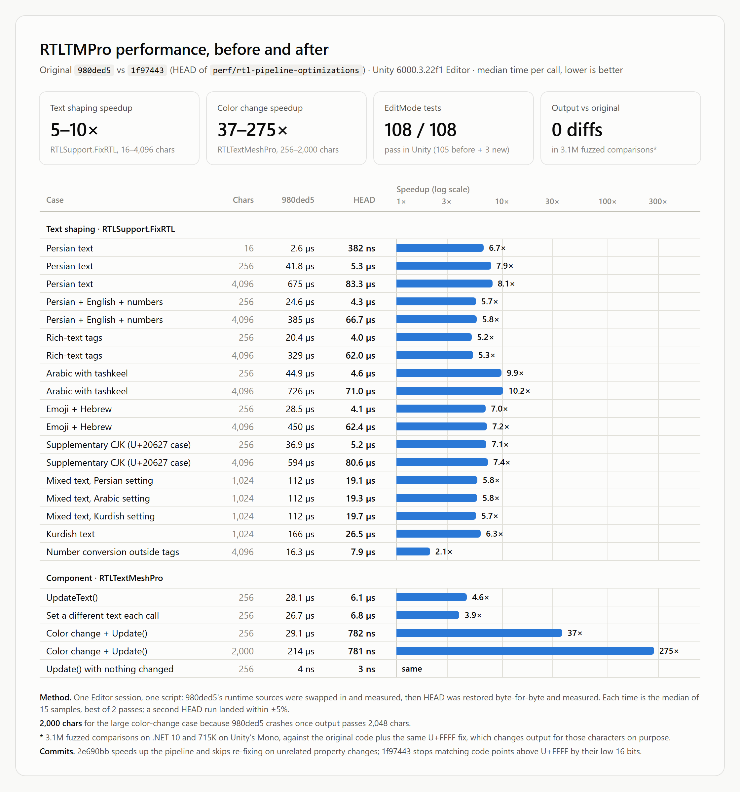

> # RTLTMPro Fork - Updates and Optional Integrations
>
> ## What's New
>
> - Added Kurdish language support, including a Kurdish character range, font asset, and demo scene.
> - Added Context Menu conversion from legacy `Text` and `TextMeshProUGUI` components to `RTLTextMeshPro`.
> - Added optional Unity Localization integration for locale-aware Persian digit conversion.
> - Added optional Unicode emoji support through Emoji Search API and TextMeshPro sprite assets.
> - Improved Unity 6 compatibility for shaders, editor menus, and Prefab Mode.
> - Fixed Persian number ordering and several RTL shaping edge cases.
> - Made RTL text shaping 5–10× faster. `RTLTextMeshPro` no longer re-shapes its text when only an unrelated property, such as color, changes. See [Performance](#performance).
> - Fixed a crash when the fixed text grew past 2,048 characters.
> - Fixed characters above U+FFFF, such as CJK Extension B ideographs, being shaped as Arabic letters.
>
> ## Performance
>
> Measured in the Unity 6000.3.22f1 Editor against the code before the optimizations (commit `980ded5`):
>
> - Text shaping (`RTLSupport.FixRTL`) is 5–10× faster, from 16 to 4,096 characters.
> - Changing a property that doesn't affect the text, such as color, costs under 1 µs instead of re-shaping it: 37× cheaper at 256 characters and 275× at 2,000.
> - The output is unchanged. Differential fuzzing against the original code found no differences apart from the U+FFFF fix above, and all 108 EditMode tests pass.
>
> 
>
> ## Installing This Fork
>
> 1. Install TextMeshPro through Unity Package Manager.
> 2. Open the [Releases](https://github.com/salehb02/RTLTMPro/releases) page and download the latest `.unitypackage` file.
> 3. In Unity, open `Assets > Import Package > Custom Package...`.
> 4. Select the downloaded package and press `Import`.
> 5. Install the optional integrations below only when your project needs them.
>
> ## Optional Integrations
>
> These packages are optional. Their integrations are enabled automatically through Assembly Definition `versionDefines`; no manual Scripting Define Symbol is required.
>
> ### Unity Localization
>
> Use this integration when the displayed number format should follow the currently selected locale.
>
> #### Installation
>
> 1. Open `Window > Package Management > Package Manager`.
> 2. Install `Localization` from the Unity Registry, or select `Install package by name` and enter `com.unity.localization`.
> 3. Configure the project's locales and set the active locale through Unity Localization.
>
> When `com.unity.localization` is installed, `RTL_LOCALIZATION` is defined automatically. `RTLTextMeshPro` then converts English digits to Persian digits when the selected locale code contains `fa`. This also applies to text without Persian letters, such as `100` or `Level 5`: it is still left-to-right and not reshaped, but its digits outside rich-text tags become Persian. The `Force Farsi Numbers` option can still be used to force Persian digits regardless of the active locale.
>
> ### Emoji Search API
>
> Use this integration to render Unicode emoji sequences with a TextMeshPro Sprite Asset.
>
> #### Installation
>
> 1. Open `Window > Package Management > Package Manager`.
> 2. Press the add button `+` and select `Install package from git URL`.
> 3. Enter `https://gitlab.com/KyubInteractive/emojisearchapi.git#com.kyub.emojisearch-1.1.5`.
> 4. Assign an emoji-compatible `TMP Sprite Asset` to the `RTLTextMeshPro` component or configure it as TextMeshPro's default sprite asset.
> 5. Use Unicode emoji directly in the text. Supported emoji sequences are converted to TextMeshPro sprite tags automatically.
>
> When `com.kyub.emojisearch` is installed, `RTL_EMOJI` is defined automatically.

---

# RTL Text Mesh Pro
This plugin adds Right-to-left language support to "TextMeshPro" Unity plugin. 
You need to have `TextMeshPro` plugin in your project. You can install TMPro via `Package Manager`.

Currently Arabic, Farsi and Hebrew are supported. If you find an issue with one of these languages or want support for another RTL language, open an issue.

- [Features](#features)
- [Installation](#installation)
- [Creating Fonts](#how-to-create-font-assets)
- [Usage](#usage-description)
- [Contribution](#contribution)

# Features
### Farsi, Arabic and Hebrew

### Realtime RTL Text
You don't need to convert, copy and paste texts. Start writing and texts will be converted right away.  
  

### Rich Text
All `Text Mesh Pro`'s tags are available in `RTL Text Mesh Pro`
  

### RTL InputField
Realtime InputField is supported.  
  
  

### RTL Dropdown 
  

### Multiline
Yes, This plugin has no problem with multiline RTL texts.
  

### AutoSize
Auto Font Size is fully supported.  
  

### English, Farsi and Arabic digits are supported
  

### Arabic Tashkeel
Arabic tashkeel are supported.  
  
  

### Zero-Width No-Joiner character support
You can insert Zero-Width No-Joiner character with Ctrl+Shift+2 hotkey.  
  
  

# Installation
> :information_source: You need to have `TextMeshPro` plugin in your project. You can install TMPro via `Package Manager`. DO NOT Install Text Mesh Pro from Asset Store.

## from Unity Package Manager (UPM) 
[hk1ll3r](https://github.com/hk1ll3r/) maintains a package manager version of this repo on [OpenUPM](https://openupm.com/packages/com.nosuchstudio.rtltmpro/).

The sample scenes and demo resources (fonts, shaders, etc.) are included in the package version as a .unitypackage file. You can optionally import them into your Assets folder to use them. From the project window navigate to the package folder and double click "RTLTMPRo-demo-resources" file to import these assets into your project.

Using the package version is recommended so you get the stable state of the repo. This however doesn't allow you to modify the scripts. You can get the packaged version in two ways.

### from Git URL [Recommended 👍]
0. Open Unity Package Manager (UPM) in Unity Editor.
1. Press the add button `+`.
2. Enter this repo's URL: https://github.com/hk1ll3r/RTLTMPro.git?path=/UPMPackage
3. Press `Install`.

### from OpenUPM
In Project Settings window, add OpenUPM as a scoped registry or if you have already added it, add the new scope to it.

Then in Package Manager window, change scope to *My Registries*. Select "RTL Text Mesh Pro" package and press *Install*.

## from .unitypackage file
Download the latest unitypackage file from the [releases](https://github.com/sorencoder/RTLTMPro/releases) section and import it into your project from "Assets -> Import Package -> Custom Package..." menu in Unity.

This will include both the scripts and the demo resources (the sample fonts and scenes) into your projects Assets folder. It is a good starting point to see everything in your project. For optimized builds of your game it is better to remove the demo resources.

# How To Create Font Assets
You need to create font assets from font files to use them with TextMeshPro. Here are basic instructions for convenience. You can check out the [official TextMeshPro documentation](https://docs.unity3d.com/Packages/com.unity.textmeshpro@4.0/manual/FontAssetsCreator.html) to learn more.
  
Open `Window/TextMeshPro/Font Asset Creator` window.

1. Assign your font in `Font Source` field (Your font must include your characters)
2. Set atlas size. For Arabic we recomment 512x512 and for Hebrew 128x128 as a minimum. A larger atlas will have better quality but larger size on disk.
3. Set `Character Set` to `Unicode Range`.
4. Copy character ranges from files under `Assets/RTLTMPro/Ranges` folder into `Character Sequence (Hex)`.
   * Arabic letters are in `ArabicLetters.txt` file
   * Arabic digits are in `ArabicDigits.txt` file
   * Arabic tashkeel letter are in `ArabicTashkeel.txt` file.
   * All arabic characters are in `ArabicAll.txt`. Normally you would use this to create your font asset.
   * Hebrew letters are in `HebrewLetters.txt`.
6. Press `Generate Font Atlas` button and wait for it to generate the atlas.
7. Press `Save TextMeshPro Font Asset` and save the font asset.
  
## Usage Description

* Use `GameObject/UI/* - RTLTMP` menu to create RTL UI elements. (Alternatively you can replace `Text Mesh Pro UGUI` components with `RTL Text Mesh Pro`)
* Assign your font asset `Font Asset` property in `RTL Text Mesh Pro` component 
* Enter text in `RTL TEXT INPUT BOX` secion.

### Farsi
When checked, English numbers will be converted to Farsi numbers.
When unchecked, English numbers will be converted to Arabic numbers.  

### Preserve Numbers
When checked numbers will not be converted.  

### Force Fix
RTL Text Mesh Pro does not fix texts that start with English characters. 
Checking this checkbox forces RTL TextMeshPro to fix the text even when it starts with English character. 
**Multiline English texts will have problem on components that have `ForceFix` checked.**  

### Fix Tags
When checked, RTL Text Mesh Pro will try to fix rich text tags.  
  
# Contribution
All contributions are welcome. Make sure you follow the project's code style. We actively monitor pull requests.

Contact: 
- sorencoder@gmail.com
- hossein.shbz@gmail.com
